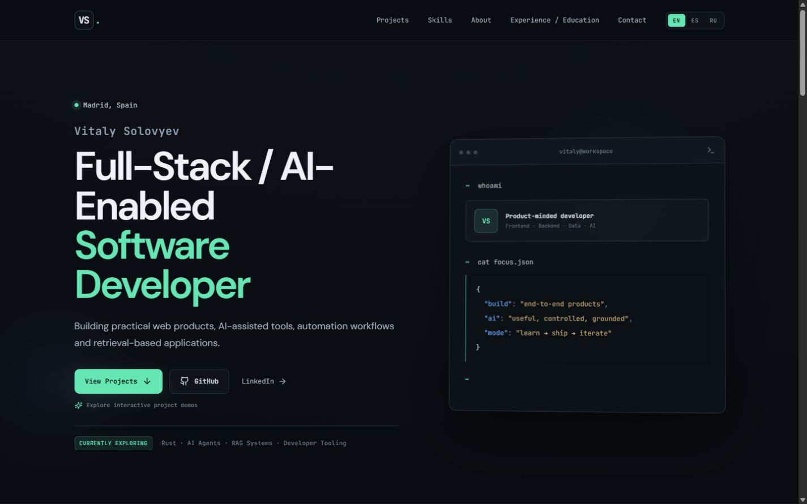

# Vitaly Solovyev — Full-Stack / AI Developer

An interactive portfolio for a Madrid-based software developer building full-stack products, AI-enabled tools, retrieval systems and controlled automation workflows.

## Live Portfolio

https://vitalyruso.github.io/

Available in English, Spanish and Russian.

- [GitHub](https://github.com/VitalyRuso)
- [LinkedIn](https://www.linkedin.com/in/vitaly-solovyev-515568426/)

## Featured Projects

- **ActionPilot** — Human-in-the-loop browser agent that observes, proposes and waits for approval before execution.
- **AI Workspace Control Center** — Local-first command center for project workflows and controlled AI-assisted tasks.
- **Spain Helper** — Retrieval-augmented information assistant for newcomers in Spain.
- **Visual Foundry** — Experimental workspace for generative 2D/3D concepts and visual workflows.

## Interactive Product Demos

ActionPilot, AI Workspace Control Center and Spain Helper have interactive client-side demonstrations in the portfolio. They simulate each product workflow locally and require no API keys or backend infrastructure.



## Stack

React 19, TypeScript, Vite, plain CSS, Lucide icons, GitHub Actions and GitHub Pages.

## Local Development

Requires Node.js 22 or later.

```bash
npm install
npm run dev
```

Production checks:

```bash
npm run lint
npm run build
```

## Deployment

The existing [GitHub Pages workflow](.github/workflows/deploy.yml) builds and publishes `dist` after pushes to `main`. This user-site repository keeps Vite's root base `/`.

Translations are local, typed application content in `src/i18n/`; no translation widget or external service is used.
